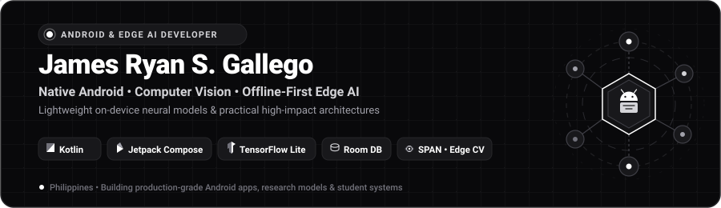
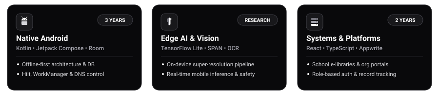
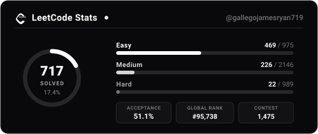
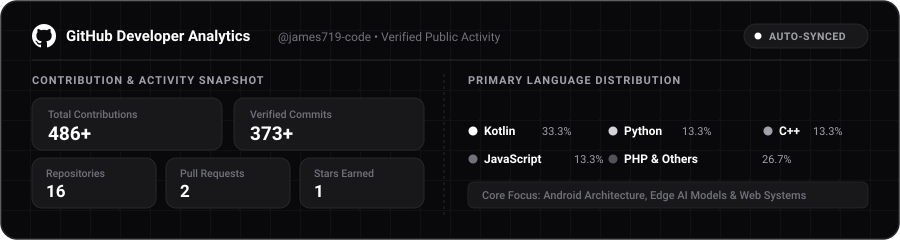
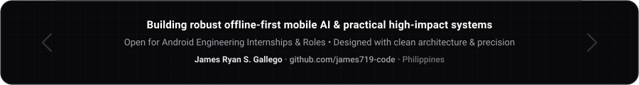

  

 

  
  
  
  

 

  

 

  

## About Me

I am a Computer Science student and software engineer from the Philippines specializing in **Native Android Development** and **Edge AI / Computer Vision**. I engineer high-performance mobile architectures, offline-first applications, and practical management systems for schools, organizations, and local communities.

My engineering philosophy centers on **clean architecture**, **resource-efficient on-device computing**, and **delightful user experiences**. Whether deploying quantized neural networks directly to mobile hardware via TensorFlow Lite or building resilient offline-first productivity applications, I focus on building reliable software that solves real-world challenges.

* **Location:** Philippines
* **Education:** Computer Science
* **Current Focus:** Jetpack Compose, Kotlin Coroutines & Flow, On-Device Super-Resolution (SPAN), Mobile OCR, TensorFlow Lite, Appwrite, Room DB
* **Core Focus:** Bridging modern on-device machine learning with production-grade Android engineering

 

  

## Experience Snapshot

  
  
  
  

 

| Domain | Experience | Core Focus & Impact |
| :--- | :---: | :--- |
| **Android Engineering** | **3 Years** | Architecture of production native Android applications using Kotlin, Java, Jetpack Compose, XML layouts, Room DB, WorkManager, Hilt, Firebase, and offline-first design patterns. |
| **Edge AI & Computer Vision** | **Research** | Lightweight deep learning model deployment using TensorFlow Lite, SPAN super-resolution for educational readability improvement, mobile OCR pipelines, and real-time screen safety classification. |
| **Web & Distributed Systems** | **2 Years** | Scalable web systems, administrative dashboards, and student community portals built with TypeScript, React, Django REST Framework, Firebase, Appwrite, and Netlify. |
| **Hardware & IoT Prototyping** | **2 Months** | Embedded systems prototyping with ESP32 and Arduino, sensor integration, hardware-software serial communication, and edge telemetry. |

 

  

## Featured Projects

A curated selection of production applications, research systems, and community platforms:

| Project | Domain | Architecture & Technologies | Key Highlights & Impact |
| :--- | :---: | :--- | :--- |
| [**ANVIL**](https://github.com/james719-code/ANVIL) | Android App | Kotlin, Jetpack Compose, Room DB, Hilt, WorkManager | Advanced productivity and application-blocking engine featuring DNS filtering, persistent background scheduling, and encrypted credential storage. |
| [**EduScale**](https://github.com/james719-code/EduScale) | Edge AI Research | TensorFlow Lite, SPAN Super-Resolution, OCR Metrics, Python | On-device super-resolution system enhancing educational video text readability locally with quantitative OCR character recognition benchmarks. |
| [**CRESTV2**](https://github.com/james719-code/CRESTV2) | Android System | Kotlin, Jetpack Compose, Firebase Auth, Appwrite Storage | Digital school research library platform featuring multi-role access control, secure PDF management, and teacher approval workflows. |
| [**SPECS Portal**](https://github.com/james719-code/SPECS-Organization-Management-System) | Web Admin System | React, TypeScript, Appwrite Database, Cloud Storage | Student organization administration system managing membership rosters, event ticketing, fee collections, digital documents, and audit logs. |
| [**SafeAI Buddy**](https://github.com/james719-code/SafeAI-Gore-Detection-System) | Mobile AI | TensorFlow Lite, Python, OpenCV, Android SDK | Real-time on-device screen-safety guardian utilizing custom-trained mobile computer vision models for instant sensitive visual content filtering. |
| [**CMS Platform**](https://github.com/james719-code/CMS) | Full-Stack Web | Django REST Framework, React, PostgreSQL, JWT | Comprehensive club management software featuring organizational hierarchy management, financial ledger tracking, and event scheduling. |

 

### Domain Ecosystem

* **Android + Edge AI:**
  * [**EduScale**](https://github.com/james719-code/EduScale) — Mobile super-resolution pipeline for learning media.
  * [**SafeAI Buddy**](https://github.com/james719-code/SafeAI-Gore-Detection-System) — Localized TFLite screen content safety classifier.
  * **Illegible Handwriting OCR** — Mobile workflow for deciphering complex handwritten scripts.
* **Android Systems & Utilities:**
  * [**ANVIL**](https://github.com/james719-code/ANVIL) — Device policy management, deep focus enforcement, and background WorkManager routines.
  * [**CRESTV2**](https://github.com/james719-code/CRESTV2) — Mobile repository for academic publications and research papers.
  * **SalbaBida** — Disaster readiness and community safety application with geospatial weather visualization.
* **Web, Admin & Cloud Systems:**
  * [**SPECS Portal**](https://github.com/james719-code/SPECS-Organization-Management-System) — Organization management platform with automated record generation.
  * [**CMS**](https://github.com/james719-code/CMS) — Student organization ERP system with role-based governance.
  * **HGDG-GAD** — Harmonized Gender and Development Guidelines project compliance evaluation tool.

 

  

## Technical Arsenal

### Languages & Runtime

  
  
  
  
  
  
  
  
  

 

### Android Ecosystem & Mobile Architecture

  
  
  
  
  
  
  
  

 

### Edge AI, Computer Vision & Machine Learning

  
  
  
  
  
  
  

 

### Backend, Cloud & Development Tools

  
  
  
  
  
  
  
  

 

### Embedded & IoT Prototyping

  
  
  

 

  

## LeetCode Problem Solving

<!-- LEETCODE:START -->

  
   
  

    <b>Problems Solved:</b> 54/3340 (1.6%) &nbsp;&bull;&nbsp;
    <b>Acceptance:</b> 62.5% &nbsp;&bull;&nbsp;
    <b>Ranking:</b> Top 15% &nbsp;&bull;&nbsp;
    <b>Contest Rating:</b> 1,580
  

<!-- LEETCODE:END -->

 

  

## GitHub Analytics

  

 

  

## Strong Fit For

* **Native Android Developer Roles & Internships** (Kotlin, Compose, Room, WorkManager, Hilt)
* **Mobile AI & Edge Inference Prototyping** (TensorFlow Lite, On-Device Super-Resolution, Mobile OCR)
* **Offline-First Systems Architecture** (Local caching, Room DB, sync engines, resilient networking)
* **Full-Stack & Community Management Web Platforms** (React, TypeScript, Appwrite, Firebase, REST APIs)
* **Applied Research & Engineering Prototyping** (Model evaluation, benchmarking, technical writing)

 

  

## Connect With Me

Feel free to connect, collaborate, or discuss Android engineering and Edge AI:

  
  
  
  

 

  

